# Task-5 — Production E-Commerce Environment on AWS

[](https://aws.amazon.com/)
[](https://aws.amazon.com/ec2/)
[](https://aws.amazon.com/ecs/)
[](https://aws.amazon.com/rds/)
[](https://aws.amazon.com/ecr/)

## Objective

Build and validate a production-style deployment of the e-commerce application in the Mumbai Region (`ap-south-1`) using private application and database tiers, an internet-facing Application Load Balancer, Amazon RDS PostgreSQL, Amazon ECR, and Amazon ECS on EC2 capacity.

## What Was Implemented

Task 5 progressed the application through two deployment stages:

1. Prepared and validated the application on EC2.
2. Created an AMI from the working host.
3. Registered EC2 application targets behind an ALB.
4. Configured a private Multi-AZ PostgreSQL database on RDS.
5. Published the container image to a private ECR repository.
6. Added ECS EC2 capacity and deployed the containerized service.
7. Reused the target group for both the EC2 and ECS stages.
8. Enabled ECS service target tracking between two and four tasks.
9. Validated the final ALB health endpoint with database connectivity.

## Verified Environment

| Component | Evidence |
|---|---|
| Region | `ap-south-1` — Asia Pacific (Mumbai) |
| VPC | `ecom-vpc-vpc`, available |
| Availability Zones | `ap-south-1a` and `ap-south-1b` |
| Public subnets | `ecom-vpc-subnet-public1-ap-south-1a`, `ecom-vpc-subnet-public2-ap-south-1b` |
| Application subnets | `app-subnet-1`, `app-subnet-2` |
| Database subnets | `db-subnet-1`, `db-subnet-2` |
| NAT | `ecom-vpc-regional-nat` |
| AMI | `app-ami`, private, status `Available` |
| Target group | `ecom-tg` |
| Target health | Four registered targets shown as `Healthy` |
| RDS instance | `shopdb`, PostgreSQL `15.19`, `db.t4g.micro` |
| RDS availability | Multi-AZ enabled; public access disabled |
| ECR repository | `ecom-app` |
| ECR image | `latest`, active, `77.78 MB` |
| ECS cluster | `ecom-ec2-cluster` |
| ECS capacity | Two EC2 container instances |
| ECS service | `ecom-service`, deployment `Success` |
| ECS tasks | `2 desired`, `2 running`, `0 pending` |
| Auto scaling | Minimum `2`, maximum `4`, CPU target `50%` |

## Architecture

```text
Internet
    |
    v
Application Load Balancer
    |
    v
Target group: ecom-tg
    |
    +-------------------------+
    |                         |
EC2 app-server-1        EC2 app-server-2
    |                         |
    +-----------+-------------+
                |
                v
        ECS service: ecom-service
        Cluster: ecom-ec2-cluster
        2 EC2 container instances
        2 running tasks
                |
                v
        Private RDS PostgreSQL
        Database: shopdb
```

The target group evidence shows the transition clearly: two EC2 application targets and two ECS container-instance targets were healthy at the time of capture. The final ALB request was served by the ECS-backed application and returned a connected database status.

## VPC and Network Design

The VPC resource map shows:

- Two Availability Zones.
- Two public subnets for the internet-facing ALB.
- Two application subnets for the EC2 and ECS application tier.
- Two database subnets for RDS.
- Public and private route tables.
- An Internet Gateway.
- A regional NAT gateway for private outbound access.

This layout keeps the database tier away from direct internet exposure while allowing the private application tier to reach required AWS and package endpoints through controlled routing.

## EC2 Preparation and AMI

The application was first validated on an EC2 instance named `app-server-1` through Systems Manager Session Manager. The captured health response was:

```json
{
  "status": "ok",
  "database": "connected"
}
```

After the host was working, the instance was converted into the private AMI `app-ami`. The AMI screenshot confirms that it reached the `Available` state and could be used as the basis for repeatable application instances.

## Load Balancer and Target Health

The target group `ecom-tg` was configured for the application port and health endpoint. The captured target table shows four healthy targets across both Availability Zones:

- `app-server-1` on port `3000`
- `app-server-2` on port `3000`
- Two ECS container instances on dynamic ports `32773` and `32771`

This demonstrates that the same ALB path was used first for the EC2 application and then for the ECS service.

## RDS PostgreSQL

The RDS screenshot verifies the `shopdb` PostgreSQL instance:

- Engine version: `15.19`
- Instance class: `db.t4g.micro`
- Multi-AZ: enabled
- Storage: `200 GiB` General Purpose SSD (`gp3`)
- Provisioned IOPS: `3000`
- Storage autoscaling: enabled
- Encryption: enabled with the AWS-managed `aws/rds` key
- Enhanced monitoring: enabled
- Backup retention: `465 days`
- Master username: `appuser`

The connectivity screenshot confirms:

- Endpoint type: instance endpoint
- Port: `5432`
- VPC: `ecom-vpc-vpc`
- Subnet group: `shop-db-subnet-group`
- Security group: `db-sg`
- Publicly accessible: `No`

The database was therefore kept private and reachable through the application network path rather than exposed directly to the internet.

## ECR Image

The private ECR repository `ecom-app` contains the `latest` image:

- URI: `584860296694.dkr.ecr.ap-south-1.amazonaws.com/ecom-app:latest`
- Status: `Active`
- Size: `77.78 MB`
- Repository: `ecom-app`

The image was available for the ECS task definition used by the final service deployment.

## ECS Deployment

The ECS console confirms:

- Cluster: `ecom-ec2-cluster`
- Capacity: `2 EC2` container instances
- Service: `ecom-service`
- Task definition: `ecom-task-ec2:2`
- Desired tasks: `2`
- Running tasks: `2`
- Pending tasks: `0`
- Deployment status: `Success`

The service ran as a replica deployment on EC2 capacity, with the ALB target group forwarding traffic to the container tasks.

## Auto Scaling

The service auto scaling configuration shows:

- Desired tasks: `2`
- Minimum tasks: `2`
- Maximum tasks: `4`
- Policy: target tracking
- Metric: `ECSServiceAverageCPUUtilization`
- CPU target: `50`
- Scale-in: enabled

This keeps a baseline of two tasks for availability while allowing the service to add capacity as average CPU utilization increases.

## Final Validation

The final browser check used the ALB endpoint:

```text
http://ecom-alb-1812614674.ap-south-1.elb.amazonaws.com/health
```

The response confirmed both application and database health:

```json
{
  "status": "ok",
  "database": "connected",
  "timestamp": "2026-11-15T15:12:50.871Z",
  "uptime": 385.723200487
}
```

This is the most important end-to-end result in the task: internet traffic reached the ALB, the ALB reached the ECS-backed application, and the application reached private PostgreSQL successfully.

## Security Decisions

- Database public access was disabled.
- RDS was placed in a dedicated database subnet group.
- The database used its own security group, `db-sg`.
- The application and database tiers were separated into different subnets.
- EC2 administration used Systems Manager Session Manager rather than a key-pair SSH workflow.
- The container image was stored in a private ECR repository.
- Credentials and secrets are excluded from this repository.

## Troubleshooting and Engineering Decisions

- Validated the application locally on EC2 before creating the AMI.
- Used AMI creation to avoid rebuilding the host configuration manually.
- Checked target health before moving traffic to the ECS service.
- Kept both EC2 and ECS target states visible during the migration.
- Confirmed the ECS deployment reached `Success` before relying on the service.
- Used the ALB health endpoint as the final cross-layer test instead of treating task status alone as proof.

## Learning Outcomes

- Designed a multi-tier AWS network across two Availability Zones.
- Used private subnets and security groups to protect the database tier.
- Administered private EC2 instances with Systems Manager.
- Created and validated a reusable AMI.
- Registered and monitored targets through an Application Load Balancer.
- Configured encrypted, Multi-AZ PostgreSQL on Amazon RDS.
- Published a container image to private ECR.
- Deployed ECS on EC2 capacity with two running tasks.
- Configured CPU-based target tracking from two to four tasks.
- Verified the complete request path with a real ALB health check.

## Screenshots

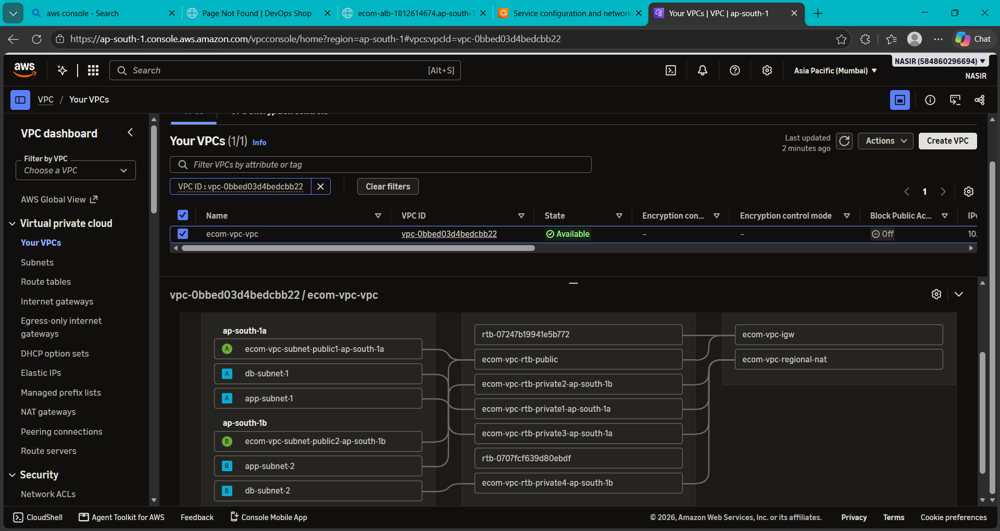

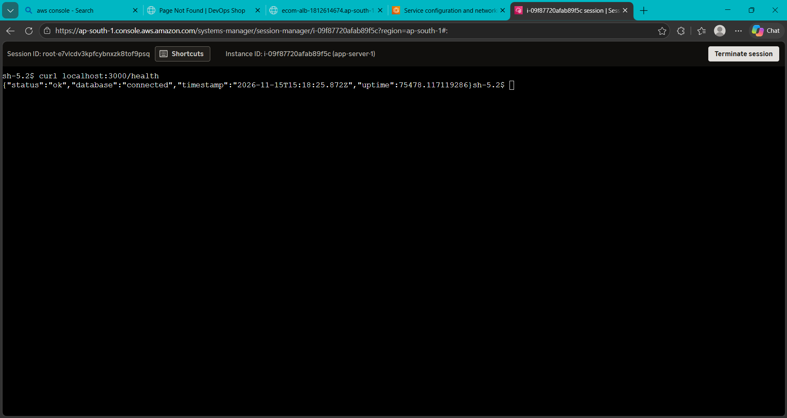

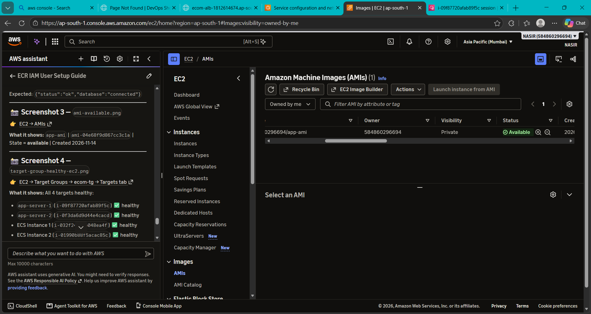

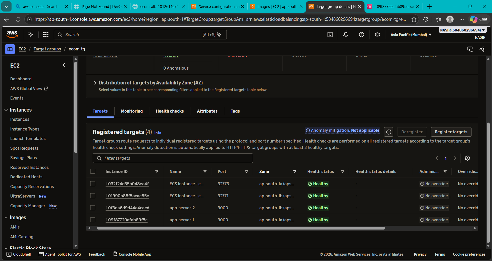

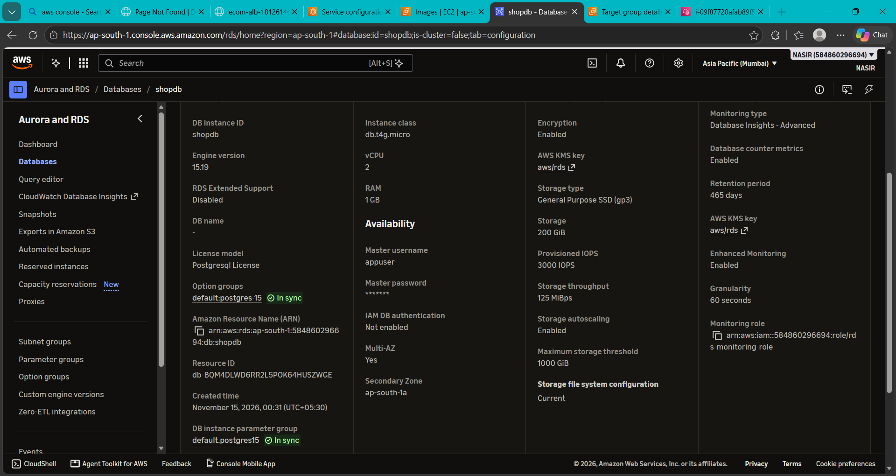

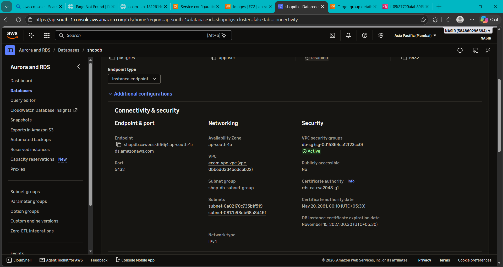

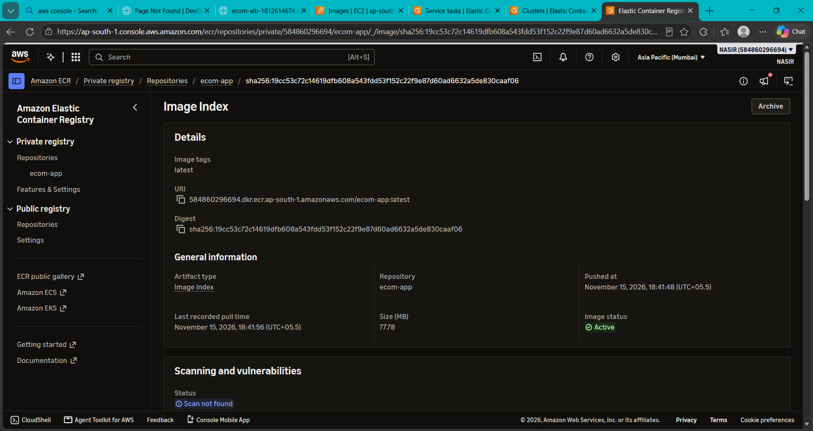

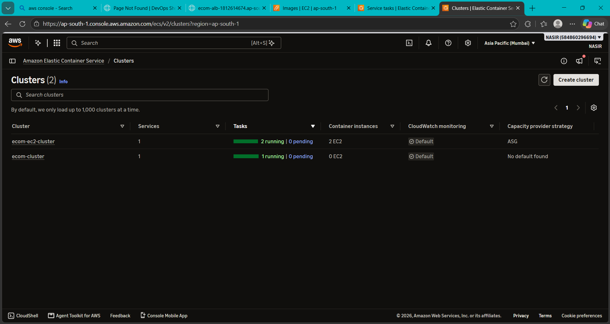

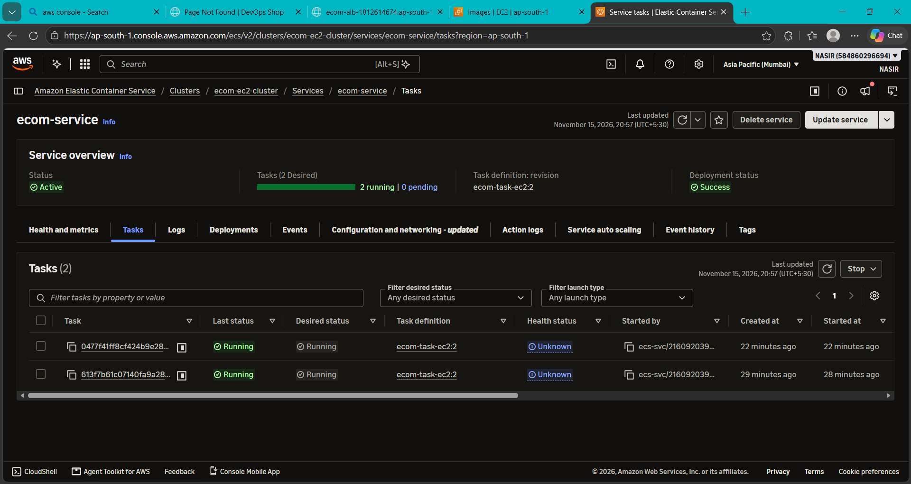

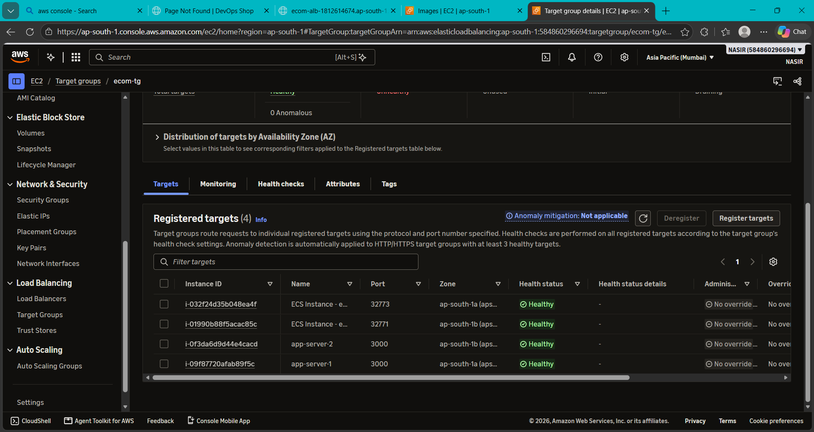

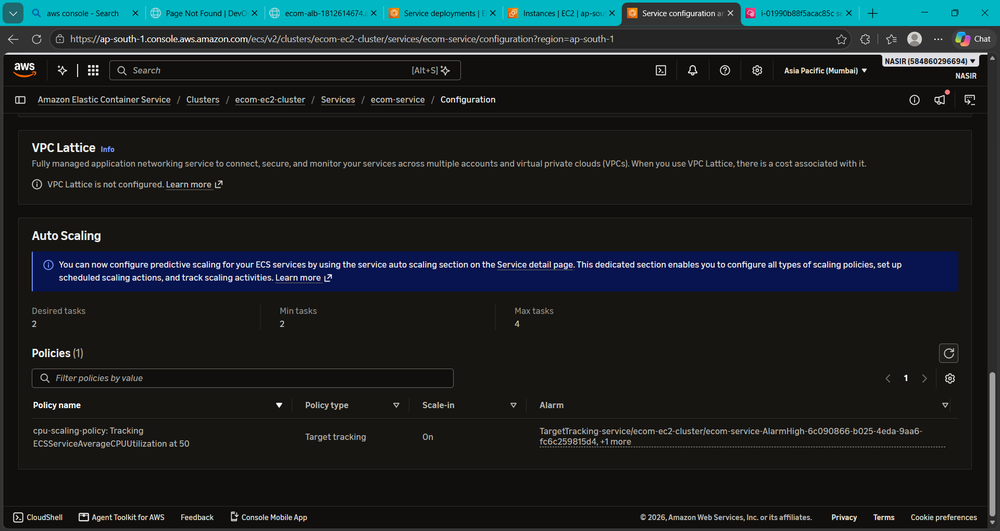

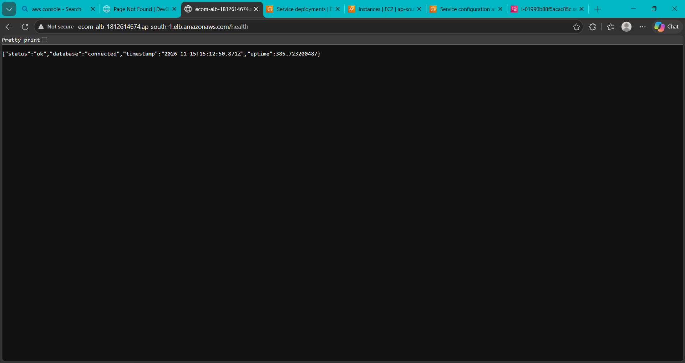

## Suggested Commit Messages

```text
feat(task-5): build multi-tier Mumbai VPC
feat(task-5): prepare EC2 application AMI
feat(task-5): configure ALB target health checks
feat(task-5): deploy encrypted Multi-AZ RDS PostgreSQL
feat(task-5): publish e-commerce image to private ECR
feat(task-5): deploy ECS service on EC2 capacity
feat(task-5): configure ECS CPU target tracking
test(task-5): validate ALB and database health
docs(task-5): document production deployment evidence
```
